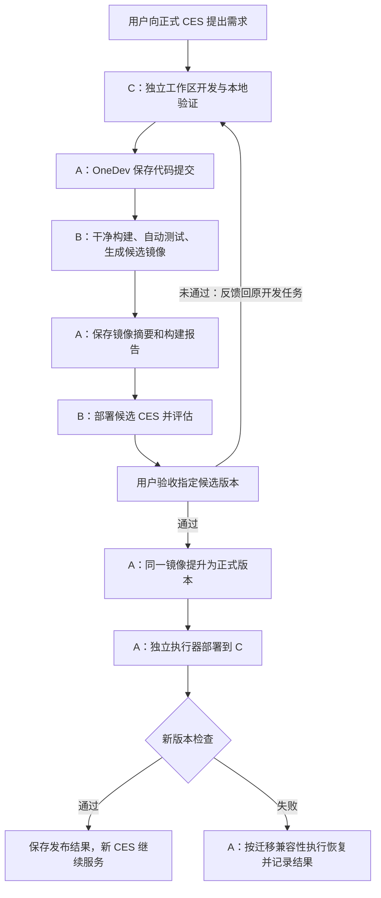

# CES 自演进服务器与基础设施方案

- 状态：已确定 OneDev 选型与三台服务器布局，待实施。
- 日期：2026-10-24。
- 工作分支：`ces/self-evolution`。
- 使用版本：**OneDev 16.9.7**，作为第一版部署基线。
- 范围：仅服务于 CES 及与 CES 相关的仓库；CES 保持单用户系统。

本文记录服务器、基础软件、存储和发布职责。

OneDev 首次初始化和 Agent 自动接入的独立验证结果见 [ONEDEV_BOOTSTRAP_VERIFICATION.md](ONEDEV_BOOTSTRAP_VERIFICATION.md)。文中的主机名、域名及路径是规划值，尚未安装软件或创建远端资源；任务名称和发布记录也属于待实现的约定。

## 1. 已确定的决策

1. 采用 OneDev 16.9.7 的代码托管、内置容器仓库和 CI/CD 能力，替代此前讨论的 Gitea 组合。
2. 使用三台服务器：A 承载基础设施及生产部署执行器，B 承载构建、测试与评估，C 承载正式 CES、生产数据和开发工作区。
3. **开发在正式服务器 C 上进行**。当前正式 CES 修改独立工作区中的源码，执行开发验证，再提交并调用流水线。
4. 候选镜像在 B 验证；用户验收后，将同一镜像提升为正式版本，由 A 发布到 C。
5. 第一版采用单候选环境、串行生产发布，允许短暂维护停机。高可用、多节点滚动升级和多候选并行不属于第一版。
6. OneDev 自身的升级独立于 CES 版本发布，不随 CES 的日常自演进任务自动升级。

16.9.7 于 2026-10-23 正式发布，选型依据见[官方发布页](https://github.com/theonedev/onedev/releases/tag/v16.9.7)。固定这一版本不代表已经完成本项目的部署验收。

## 2. 三台服务器的分工

| 主机 | 角色 | 运行内容 | 主要持久数据 |
| --- | --- | --- | --- |
| A：`ces-infra` | 基础设施及生产发布 | OneDev 16.9.7、独立 PostgreSQL、Caddy、专用发布 Agent、SSH 客户端 | Git 仓库、镜像、构建记录和产物、基础设施配置、发布记录 |
| B：`ces-test` | 构建、测试与评估 | 构建 Agent、Buildx/BuildKit、候选 CES、独立测试 PostgreSQL、Playwright、评估任务、Caddy | 测试数据、测试配置、构建缓存；重要报告归档至 A |
| C：`ces-prod` | 正式运行及开发 | 正式 CES、生产 PostgreSQL、独立开发环境、Git、Node.js/npm、TOD、Caddy | 生产业务数据、dsh 配置和密钥、会话与工作区数据、开发仓库 |

三台可以是云主机或虚拟机。B 与 C 使用相同 CPU 架构和一致的应用运行环境，第一版建议统一为 Linux amd64，避免测试与生产运行不同平台的镜像。

### 2.1 起步资源估算

以下按单用户、单个构建任务、模型使用外部 API 估算，不包含本地模型推理；属于初始预算建议，需根据实际构建峰值和镜像留存量调整。

| 主机 | vCPU | 内存 | SSD 起步容量 | 主要容量来源 |
| --- | --- | --- | --- | --- |
| A | 2 | 4 GiB | 100 GiB | 仓库、镜像历史、报告与基础设施数据库 |
| B | 4 | 8 GiB | 150 GiB | npm 缓存、镜像构建层、浏览器和测试容器 |
| C | 4 | 8 GiB | 100 GiB | 正式 CES、开发检查、生产数据库和工作区 |

构建和本地测试设置资源上限；C 的开发检查不能耗尽正式 CES 的内存。镜像、日志和缓存分别设置留存策略，当前生产版本与上一可回退版本不进入普通清理范围。

## 3. 基础软件清单

| 能力 | 软件或组件 | 部署位置 | 版本与实施要求 |
| --- | --- | --- | --- |
| 操作系统 | Ubuntu Server 24.04 LTS | A、B、C | 统一系统基线，持续安装适用的安全更新 |
| 容器运行及编排 | Docker Engine、Compose 插件 | A、B、C | 核定后记录具体版本；服务、卷和网络使用独立 Compose 项目 |
| 代码仓库 | OneDev | A | **固定 16.9.7**，仅承载 CES 相关仓库 |
| 镜像仓库 | OneDev 内置 Container Registry | A | 与 OneDev 同版本；启用对应项目的包管理 |
| 流水线控制 | OneDev 内置 CI/CD | A | 与 OneDev 同版本，构建规范纳入版本控制 |
| 构建执行 | OneDev Agent、Buildx/BuildKit | B | Agent 按 16.9.7 实例提供的匹配安装包或镜像配置；首次并发为 1 |
| 生产部署执行 | 独立 OneDev Agent、OpenSSH 客户端 | A | 仅执行指定部署与恢复任务，工作目录和凭据独立于普通构建任务 |
| HTTPS 入口 | Caddy | A、B、C | 每台提供自己的域名入口，持久化证书数据 |
| 数据库 | PostgreSQL | A、B、C | A、B、C 各自独立实例；B、C 使用与现有 CES 核对一致的主版本 |
| 开发工具链 | Git CLI、Node.js、npm、TOD | C 开发环境；B 按任务提供工具链 | Node.js 版本结合现有测试及 dsh 兼容性固定；TOD 与 OneDev 16.9.7 联调后固定版本 |
| CES 宿主 | dsh 与 CES 插件 | B、C 的 CES 镜像 | 当前 dsh 基线为 `0.2.1-alpha.5`；插件、patch、迁移及运行依赖一起打包 |
| 页面和接口测试 | Playwright、Chromium、项目现有测试 | B；C 按开发任务需要提供 | Playwright 包与浏览器镜像版本匹配 |
| 场景评估 | CES 场景评估脚本 | B | 待开发，验证任务完成情况、工具调用和回归行为 |
| 备份与恢复 | PostgreSQL 导出/恢复工具、restic | A、C；B 按需 | 数据库一致性导出和文件备份分开处理，备份发送到异机或对象存储 |

OneDev 核心 CI/CD 和包仓库属于社区版能力，第一版不依赖其企业版专属功能，见[版本功能说明](https://onedev.io/pricing)。除 OneDev 和现有 dsh 基线外，尚未核定的软件具体版本应在部署清单中补齐，不能将本表理解为所有兼容性已经验证。

### 3.1 OneDev 的版本固定

- 服务端必须实际运行 16.9.7。实施时从官方镜像仓库核对该版本的镜像标签和平台摘要，记录完整引用；本方案不预填未经核验的摘要。
- 服务端、Agent 和 TOD 记录为一套兼容组合。Agent 按服务端的配套和更新机制管理，不假定 Agent 与服务端的镜像标签相同。
- 通过固定镜像引用启动服务，不用浮动 `latest` 决定下次启动的软件版本。
- 后续升级先核对对应版本的兼容性说明，再验证 Git、镜像、任务调度、日志读取和恢复流程。
- 在线文档可能更新；实施时以 16.9.7 实例的 API 帮助和构建规范校验结果为准。

## 4. 开发和运行目录

正式 CES 负责开发自己的代码，开发文件和正在运行的程序文件保持独立。

| 位置 | 规划路径 | 内容 |
| --- | --- | --- |
| A | `/srv/ces-infra/onedev` | OneDev 文件数据与配置 |
| A | `/srv/ces-infra/postgres` | OneDev 数据库持久卷 |
| A | `/srv/ces-infra/deploy` | 发布 Agent 工作目录、部署清单和发布日志 |
| B | `/srv/ces-test/agent` | 构建 Agent 工作目录和缓存 |
| B | `/srv/ces-test/runtime` | 候选 CES 的环境配置和 Compose 配置 |
| B | `/srv/ces-test/data` | 独立测试数据库、dsh home 和测试工作区 |
| C | `/srv/ces-prod/runtime` | 正式 CES 的 Compose 配置、当前版本清单 |
| C | `/srv/ces-prod/data` | 生产 PostgreSQL、dsh home、模型配置、密钥和业务工作区 |
| C | `/srv/ces-dev/repos` | CES 及关联源码仓库 |
| C | `/srv/ces-dev/worktrees` | 各开发任务的独立工作树 |

正式容器可访问分配给开发任务的工作区，但其程序与插件从已发布镜像加载。源码编译到开发目录，不覆盖正式容器加载的 `lib` 或运行配置。开发依赖放在开发环境中，不随版本替换丢失未提交工作。

C 上允许运行本地单元测试和开发预览；开发预览使用独立端口、配置及临时数据。接入数据库的测试不得复用生产数据库。提交后的干净构建、集成测试与候选部署统一在 B 执行。

TOD 的本地修改验证作为开发辅助；用于正式候选发布的代码必须形成可追溯、可长期取回的仓库提交。不能把可覆盖的临时引用当作正式版本依据，见[本地修改验证说明](https://docs.onedev.io/tutorials/cicd/run-job-against-local-change)。

## 5. 网络和服务入口

以下域名仅为示例，实际域名和 IP 在部署清单中登记。

| 入口或连接 | 规划 | 用途 |
| --- | --- | --- |
| 用户、CES、Agent → A | `https://dev.ces.example.com` | OneDev Web、API、Git HTTPS 和内置容器仓库 |
| 用户、正式 CES → B | `https://test.ces.example.com` | 候选版访问、接口及浏览器验证 |
| 用户 → C | `https://ces.example.com` | 正式 CES |
| A 的发布执行器 → C | 私网 SSH | 执行部署、健康检查和回退，校验主机身份 |
| B、C → A | HTTPS 镜像推拉 | B 推送候选镜像，B、C 拉取指定摘要的镜像 |
| A、C → 备份目标 | SFTP 或对象存储协议 | 保存离机备份 |

- Caddy 对外提供 HTTPS；HTTP 入口按证书验证及跳转需要配置。
- OneDev 的 Web 服务端口 `6610` 和 CES 的 `9090` 作为内部入口，不直接承担公开访问。
- Git 默认走 HTTPS；如启用 OneDev Git SSH，单独配置其端口及转发，不与主机管理 SSH 混用。
- PostgreSQL 仅向本机或指定容器网络开放，不让 B 连接 C 的生产数据库。
- OneDev 对外地址也必须能从 Agent、构建容器和 BuildKit 内访问，不能配置为只在宿主可用的 `localhost`。
- 三台在同一私网或具备明确的点对点连接；正式入口不依赖 A 的反向代理，A 停机时 C 仍能提供已有版本的服务。

## 6. OneDev 项目与执行器

### 6.1 项目组织

第一版采用一个 CES 主仓库，相关仓库按需要添加。流水线规范放在对应仓库中，使用 `.onedev-buildspec.yml`；不迁入与 CES 无关的项目。

构建、测试和发布任务都明确指定执行器，避免自动发现执行器使重型构建落到 A。

| 执行器约定名 | 所在主机 | 可执行内容 | 初始并发 |
| --- | --- | --- | --- |
| `ces-build-test` | B 的构建 Agent | 检查、构建镜像、候选部署、场景评估 | 1 |
| `ces-production-deploy` | A 的专用发布 Agent | 指定版本发布、健康检查、状态核对、失败恢复 | 1 |

按项目和任务限定执行器匹配范围。A 的发布 Agent 不承担候选代码的普通构建任务；它的进程与 C 的 CES 生命周期独立。Agent 和执行器配置方式见[官方 Agent 说明](https://docs.onedev.io/tutorials/cicd/agent-farm)。

### 6.2 构建镜像的配置

16.9.7 已包含 16.8.4 引入的 Buildx 安全默认值：镜像构建及部分 Buildx 操作需要在相应 Docker 执行器上明确启用。按本方案所用步骤，只在 B 的指定执行器开启所需选项；部署 Agent 只消费镜像。

内置镜像仓库需启用项目包管理，并配置具有对应项目读写范围的凭据。使用官方建议的构建关联方式保留镜像与构建之间的关系，见[容器镜像说明](https://docs.onedev.io/tutorials/package/working-with-container-image)。

### 6.3 CES 的操作入口

正式 CES 通过 TOD 或 OneDev API 完成提交后任务触发、状态查询、日志和报告读取、候选状态查看及生产发布请求。具体 CES 工具接口另行实现，工具描述必须提供参数含义、前置条件和返回结果，不依赖模型阅读项目源码来学习操作。

第一版不要求启用 OneDev 自身的 AI 用户或远程开发工作区。开发对话和本地代码修改继续由 C 上的正式 CES 完成。

## 7. 自演进与发布流程

1. 正式 CES 在 C 的独立工作树内修改代码并执行开发检查。开发失败在原任务中继续修正。
2. 将候选代码提交到 OneDev，记录准确的提交 SHA。B 从该提交干净检出，执行构建和自动测试。
3. 生成候选镜像并推送到 A，记录镜像摘要、平台、构建标识和评估输入版本。B 按该摘要部署候选 CES，保存测试地址、结果和日志。
4. 正式 CES 读取验证结果并向用户说明。用户测试候选服务；不满意时反馈回 C 上的原开发任务。替换候选环境时明确其新版本，旧验收不自动转移。
5. 用户验收通过后，将该候选镜像提升为正式版本，可增加发布标签，生产仍按摘要部署。此阶段不重新构建镜像。
6. A 的发布执行器确认目标版本、当前生产版本和恢复条件，暂停接收需要中断的工作，等待或按既有恢复语义处理在途任务，完成落盘和备份，然后替换 C 上的应用容器。
7. 验证新版本的登录、核心插件、数据库连接、会话读取和必要工具功能。成功后记录生效版本；失败时由 A 执行恢复或保留维护状态，并给出确定的故障结果。

如果验收后又修改代码、重新构建，或合并产生了不同的代码内容，就创建新的候选并重新验证。OneDev 的 Build Promotion 用于关联上游构建和下游发布，但部署逻辑仍要核对实际依赖与镜像摘要，见[官方构建提升说明](https://docs.onedev.io/tutorials/cicd/build-promotion)。

### 7.1 验收与工具权限

CES 保持单用户。验收由同一用户在对话中表达，记录对应的候选版本，不引入多用户审核角色或额外的强审批流程。

“完全访问”模式沿用现有工具权限语义，允许跳过工具层的逐次权限审批；本流程中的用户验收是对具体版本满足需求的确认。发布工具不因流水线包含多个步骤而重复要求同一份验收。

### 7.2 发布记录与恢复

发布记录至少包含：开发任务标识、仓库与提交 SHA、OneDev 构建标识、镜像摘要和平台、测试报告、用户验收记录、发布标识、发布前后的生产版本、备份引用、迁移说明、健康检查及恢复结果。

构建产物及日志归档在 A；发布执行器在 A 持久记录阶段与结果，C 保存当前生效版本清单。CES 数据库可以保存任务关联，但不能是部署过程中唯一的进度来源。Agent 或主机重启后，先核对实际容器、数据库和版本清单，再决定继续、恢复或结束。

同一发布标识重复提交应查询或接续已有任务，不重复执行。除执行器并发限制外，部署脚本还需对 C 的生产环境加互斥锁，避免重试或手工恢复与发布同时运行。

## 8. 测试数据、持久化与数据库迁移

### 8.1 环境隔离

- A 的 OneDev 数据库、B 的测试数据库、C 的生产数据库分别维护，不共享账户密码或数据目录。
- B 使用测试账户数据、测试凭据、独立加密密钥和独立模型配置。若使用生产数据样本，先脱敏并移除生产访问凭据和任务。
- 测试 CES 的服务器清单、巡检、指标采集及任务调度仅面向测试资源。现有服务器管理插件会在启动时运行后台工作，不能仅靠“不点按钮”避免访问生产资源。
- 正式版本替换时，保留 C 上的 PostgreSQL、dsh profile/home、Fernet key、会话签名密钥、模型配置和工作区。可随版本变化的插件代码及静态资源从镜像加载。

### 8.2 迁移与回退

当前 database 插件启动时自动执行迁移；迁移 runner 没有全局迁移锁或数据库降级执行器，见[数据库启动逻辑](../../../plugins/database/src/index.ts)和[迁移 runner](../../../plugins/database/src/migrate.ts)。

第一版以串行替换控制迁移唯一执行者，不让新旧 CES 同时对生产库运行迁移。常规自演进发布采用向后兼容的数据库变更，使上一镜像仍能使用升级后的数据库。

破坏性迁移或不兼容配置变更应单独提供恢复方案，不能承诺仅退回镜像即可恢复。恢复数据库备份可能丢失备份之后的写入，因此不能作为所有失败场景的默认自动动作。数据库状态不确定时先保留数据和维护状态，再核对恢复条件。

会话历史持久化不等于保留运行中的模型调用、SSH 连接或进程内状态。停止前需等待必要落盘；重启后的业务任务按现有数据库与远端操作日志恢复，见[执行与恢复](../../framework/modules/server-management/execution-and-upgrades.md)。

### 8.3 备份与保留

A 备份 OneDev 数据库、文件数据及部署记录；C 备份生产数据库、配置、密钥及不可重建的工作区。数据库使用一致性备份方式，不直接复制运行中的 PostgreSQL 数据目录充当可恢复备份。

第一版可采用定期逻辑备份、发布前备份和 restic 文件备份，并明确其恢复点粒度；如需持续恢复到任意时间点，另行增加 PostgreSQL 基础备份和 WAL 归档。备份保留在独立故障域，并验证恢复。当前生产及上一可回退镜像的保护规则应与发布记录联动，避免被构建或包留存策略清理。

## 9. 当前项目需要补齐的实施项

| 实施项 | 交付结果 |
| --- | --- |
| CES 可分发运行包 | 固定 dsh、Node.js、依赖、插件、客户端资源、patch 和迁移；干净检出能够构建 |
| 依赖来源整理 | 移除构建对本机忽略目录的隐式依赖，处理当前 `file:../../tmp/dsh-cli/...` 一类依赖来源 |
| 新环境建库 | 补齐 `accounts`、`wallets` 等既有 SMP 基线的正式初始化方案，并验证空库安装和已有库升级 |
| 三台部署清单 | 确认 IP、域名、具体软件版本、镜像摘要、持久卷及凭据注入方式 |
| OneDev 流水线 | 创建构建、候选部署、评估和正式发布任务，明确执行器、报告和镜像关联 |
| CES 自演进接入 | 提供任务触发、状态读取、日志与报告读取、验收记录和发布入口 |
| 部署与恢复脚本 | 实现生产锁、阶段落盘、健康检查、幂等处理、数据库兼容性检查和恢复路径 |
| 自动评估 | 覆盖登录与会话、工作区、工具权限及作用域、服务器功能、本次改动及升级恢复 |

以上均是后续实施工作，本次文档不表示这些能力已经实现。项目现有约束见[启动与配置](../../framework/operations/configuration-and-startup.md)和[存储与迁移](../../framework/data/storage-and-migrations.md)。

## 10. 部署验收标准

1. A 实际运行 OneDev 16.9.7，服务端、Agent、TOD、数据库和镜像摘要已登记，重启保持版本与数据。
2. 正式 CES 能在 C 开发、执行本地检查、提交代码，并读取 B 的流水线结果；开发过程不覆盖当前正式程序。
3. B 能从干净提交构建镜像，使用独立配置和数据运行候选 CES，报告关联到具体构建和镜像。
4. 用户验收的镜像与生产部署的镜像摘要一致；旧候选的验收不能发布新候选。
5. C 的 CES 停止后，A 仍能完成发布、检查或恢复；不依赖原对话持续在线。
6. 部署重复请求、Agent 重启及 SSH 中断不会产生并发替换或错误成功状态。
7. 完成一次兼容数据库变更的升级与回退演练，验证会话、密钥及工作区连续性。
8. 完成 A、C 备份的恢复验证，确认回退镜像和关键报告未被清理。

## 11. 官方资料

资料核对日期为 2026-10-24；后续实施优先对照选定版本，在线文档中的更新能力不自动纳入基线。

- [OneDev 16.9.7 正式发布](https://github.com/theonedev/onedev/releases/tag/v16.9.7)
- [OneDev 16.9.7 随版兼容性说明](https://code.onedev.io/onedev/server/~builds/8763/markdown/Incompatibilities/server-product/system/incompatibilities/incompatibilities.md)
- [OneDev Docker 部署与外部数据库](https://docs.onedev.io/installation-guide/run-as-docker-container)
- [OneDev 备份与恢复](https://docs.onedev.io/administration-guide/backup-restore)
- [OneDev API 帮助入口](https://docs.onedev.io/restful-api)
- [TOD CLI 与构建规范校验](https://docs.onedev.io/tutorials/ai/working-with-tod-and-skills)
- [Docker 镜像摘要](https://docs.docker.com/dhi/explore/security-concepts/digests/)
- [Playwright 容器及版本匹配](https://playwright.dev/docs/docker)
