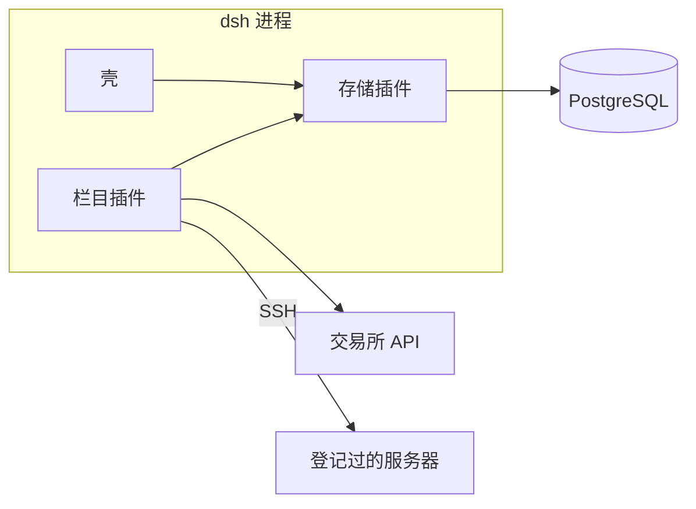

# 遥控器控制台（remote-console）

状态：待评审。本文只描述要构建的插件和构建方式，不包含实现。

运行版本钉在 `dsh` `0.2.1-alpha.5`。插件写法以 `.agents/skills/dsh-plugin/` 为准。

## 1. 背景

策略控制台现在拆成四段：浏览器里的栏目插件、Python 网站后台、Python 运维服务、PostgreSQL。页面点一个按钮，网站后台往 `ops_jobs` 插一行，运维服务再把这行领走，通过 SSH、加密库或交易所接口把结果写回同一张库。两边用内部令牌互相认证，数据库还拆了 `web_api` 和 `ops` 两个账号。

这样拆，是为了让网站进程崩溃时不要带走正在执行的 SSH。控制台本身不跑策略。策略容器在登记过的服务器上，由那台机器上的 Docker 按重启策略继续跑。控制台崩溃只影响这一次点击和这一页的显示。

因此控制台不需要自己的后台进程，也不需要和第二套进程做隔离。它是遥控器：页面、登记、原来运维服务里的动作，都放进同一个 `dsh` 进程的插件。外面只留数据库、插件进程里用到的协议客户端，以及第三方 API。

`smp` 里 `docs/design/dsh-console-plugins/` 描述的是上一步：页面已经嵌进 `dsh`，接口仍转到网站后台。那一步到此为止。本文替换「把网站后台改写成 TypeScript、继续调用运维服务」的打算。

## 2. 目标

- 浏览器打开的仍是 `dsh web`，本进程默认听 `9090`，地址是 `http://127.0.0.1:9090/`。`smp` 里正在跑的控制台继续用 `8080`，两边同时开。栏目划分保持现在的壳、仪表盘、数字货币、资金账户、服务器、平台设置。
- 每个栏目插件带上自己的宿主端。宿主端直接读写现有 PostgreSQL，并在需要时调用交易所 API 或 SSH。
- 原来运维服务做的事改由服务器插件承担：连接测试、安装组件、巡检、采指标、终端。
- `dsh` 崩溃后重启即可。数据库里的登记还在，远端容器还在。重启前没做完的 SSH 记为失败，由人再点一次。

## 3. 非目标

- 不把交易所、模型、Docker 引擎写进这个仓库。模型仍由 `dsh` 自己的接口去调。交易所通过它们的 HTTP API 调用。
- 不新增消息队列、缓存或第二套任务进程。`ops_jobs` 只作为一次动作的状态记录，供页面查看。
- 不改现有表的含义，也不在本文里重做登记模型。
- 不实现运维服务里尚未实现的策略动作（`deploy`、`start`、`stop`、`restart`、`logs`）。交易策略页保持现在的空面板。
- 不把控制台插件发布到插件市场。
- 不做多用户和公开访问。登录仍是库里的那一个账户。

## 4. 已定决策

| 事项 | 决定 |
| --- | --- |
| 进程 | 只有 `dsh`。网站后台、运维服务、单独的迁移容器都不再运行 |
| 数据 | 插件通过 Cordis 服务拿到同一个连接池，直接读写 PostgreSQL |
| 密钥 | 加密密钥放在存储插件的配置里。SSH 私钥、交易所凭证、钱包助记词、卡号只以密文入库 |
| 运维动作 | 服务器插件在自己的 effect 里执行。HTTP 请求只写入任务行并返回，不等待 SSH 结束 |
| 第三方 API | 行情和余额由数字货币插件调用交易所 API。军师的模型调用仍走 `dsh` |
| 协议客户端 | SSH、密文、助记词派生是插件依赖的库，在 `dsh` 进程内调用，不另起服务 |
| 接口 | 浏览器走插件登记的 `/console-api`、`/login`、`/mcp`。`/api` 仍属于 `dsh` |
| 登录 | 壳插件签发 `smp_session`。没有会话时打开 `/login` |
| 端口 | 本进程默认 `9090`。`smp` 的控制台留在 `8080`，不共用、不互相代理 |
| 崩溃 | 重启 `dsh`。启动时把上次留下的 `running` 任务标为失败 |

## 5. 组成



插件只通过三类东西碰到进程外面：

| 种类 | 这一版用什么 | 谁去连 |
| --- | --- | --- |
| 数据库 | 现有 PostgreSQL | 存储插件持有连接池，栏目插件注入后自己写 SQL |
| 协议客户端 | SSH 库、密文库、助记词派生 | 用到它的那个栏目插件，调用发生在 effect 里 |
| 第三方 API | 交易所的 HTTP API；模型由 `dsh` 调 | 数字货币插件；军师不经过控制台插件 |

存储插件不提供 HTTP，也不是原来的网站后台。它存在，是因为连接池和加密密钥必须有一个所有者：栏目插件卸载时先停掉自己的请求、定时器和 SSH，然后再关池子。

## 6. 插件

包都放在本仓库，每个插件一个目录，不放进 Harness 的 workspace。共享的面板组件做成库 `@smp/console-kit`，由各插件的客户端构建打进去。这个库没有 `apply`，不进补丁。

| 插件 | 页面 | 宿主端 |
| --- | --- | --- |
| `@smp/console-store` | 无 | 连接池、密文、启动时迁移。提供 `database` 和 `secrets` |
| `@smp/console-shell` | 侧栏、登录页、登录安全、军师 | 签发和校验 `smp_session`，登记 `/login` 和登录安全 |
| `@smp/console-dashboard` | 仪表盘 | 空。有数字可显示时再直接读库 |
| `@smp/console-quant` | 概览、行情、交易所、交易策略 | 交易所账户；调用交易所 API 取余额和行情 |
| `@smp/console-accounts` | 钱包、钱包详情、虚拟信用卡 | 这些表的读写；进程内派生地址 |
| `@smp/console-servers` | 服务器、详情、登记、终端、密钥 | 服务器、分组、密钥、容器清单、任务、巡检、采指标、组件安装、终端 |
| `@smp/console-settings` | MCP | MCP 开关和 `/mcp` |

栏目插件只往壳声明的 `console.page` 登记页面，并带上 `label` 和 `order`。同一 `group` 的页面合成侧栏的一项，顶部页签用各页自己的 `label`。没写 `group` 的页面单独成为一项。`placement: 'footer'` 的组固定在侧栏底部。壳自己登记「平台设置」：组 `platform`，页签「登录安全」，放在底部。其他栏目不在壳里写死。侧栏仍由壳以优先级 `-100` 占用。`conversation` 留给 `dsh` 会话，点「军师」时 `selectPanel(null)`。槽位只留下 `label` 和 `order`，所以组名、组的标题和位置附在 `label` 函数上。

跨栏目的读取走数据库，不走另一个插件的 HTTP。例如 MCP 要列出服务器时，设置插件读 `servers` 表，不请求服务器插件的路由。

### 6.1 存储

`inject` 为空。配置至少包括数据库地址和加密密钥，缺了就加载失败。

`apply` 里打开连接池、准备密文工具、执行尚未应用的 SQL 迁移，再用 `provide` 交出 `database` 和 `secrets`。这两项放在 effect 的最后发布，卸载时先撤回服务，再关池子。

表结构沿用 `smp` 里已经迁移到头的 PostgreSQL。本插件的迁移从该状态往后加，不在插件启动时重放 Python Alembic。

### 6.2 壳

宿主 `inject` 为 `['connection', 'webServer', 'database']`。

- `/login` 仍是单独页面。已有 `smp_session` 时转到 `/`。
- 用 `database` 核对 `accounts`。空表时用配置里的初始用户名和密码插入一行；没配初始密码且表是空的，加载失败。
- 替换现在壳里为了询问网站后台而拉起的子进程，以及进程内那份会话缓存。一次校验用完即丢，不在模块顶层留缓存。
- 没有会话时，索引门禁把浏览器送到 `/login`，并清掉 `dsh` 发给浏览器的登录 cookie。有会话时放行页面，军师连接沿用现在的换票方式。启动 token 仍留在进程里。
- 登录安全在壳里：修改用户名、密码和两步验证。改密码时用同一套口令把钱包助记词重新加密。用户名改掉后重新签发 `smp_session`。

客户端 `inject` 为 `['slots']`，另外使用 `layout`、`sessions`、`uiWorkspace`、`workspaces`。当前选中的页面是这次 `apply` 里的状态，键来自已登记的 `console.page`，不放在模块级变量上。壳登记的页面键是 `settings`，它在底部的「平台设置」里，页签是「登录安全」。

### 6.3 服务器

这个插件承接现在的运维服务。宿主 `inject` 为 `['webServer', 'database', 'secrets']`。

页面触发的动作只插入 `ops_jobs` 并返回。同一台服务器同时只执行一个动作，这个限制写在该插件的 effect 里。执行的动作只有现在已经实现的三种：

| 动作 | 行为 |
| --- | --- |
| `test_connection` | SSH 登录，按登记项安装所选组件，钉住主机密钥指纹 |
| `install_components` | SSH 登录，按组件目录安装全部已选组件 |
| `inspect` | SSH 执行容器清单命令，覆盖 `server_containers` |

组件目录由配置给出，内容仍是现在的 `component.json`、`detect.sh`、`install.sh`。目录不存在时加载失败。

另外两个 effect：

- 巡检定时器。对可达服务器按配置间隔插入 `inspect`。默认间隔保持 30 秒。
- 采指标。对已登记服务器采样 CPU、内存和磁盘，写回 `servers`。默认间隔保持 1 秒。

终端用 `webServer` 登记现在的 WebSocket 路径 `/console-api/servers/:id/terminal`。套接字关闭或插件卸载时断开 SSH。HTTP 与 WebSocket 都先校验 `smp_session`。

`dsh` 启动时，把状态仍为 `running` 的任务标为失败，摘录写明进程已重启。不尝试接回上一次的 SSH。

### 6.4 资金账户

宿主 `inject` 为 `['webServer', 'database', 'secrets']`。

钱包、派生账户、地址和虚拟信用卡的读写留在这个插件。助记词派生调用库函数，不再单独跑 `wallet-deriver` 进程。助记词、卡号和 CVV 经 `secrets` 加密后入库，列表接口不返回原文。

### 6.5 数字货币

宿主 `inject` 为 `['webServer', 'database', 'secrets']`。

交易所账户写入 `exchange_accounts`。刷新余额和解行情时，插件解密凭证并调用该交易所的 HTTP API，把结果写回同一行。凭证不进日志，响应不回传密钥。

概览和交易策略仍是空面板。策略的部署不在本插件里补做。

### 6.6 平台设置

宿主 `inject` 为 `['webServer', 'database', 'consoleSession']`。

登录安全属于壳，已经在「平台设置」里。这个插件只负责 MCP：读写 `mcp_settings`，并登记 `/mcp`。页面登记到同一组 `platform`，页签是「MCP」，因此仍出现在侧栏底部的「平台设置」中。令牌只在生成时返回一次，库里存哈希。`/mcp` 按该行的开关决定是否读出服务器、钱包和信用卡。

### 6.7 仪表盘

只有客户端。当前没有可汇总的数据，宿主保持空的 `apply`。以后要显示数字时，注入 `database` 直接查询，不为仪表盘再加一层接口。

## 7. 怎么构建

每个插件是独立的 ESM 包，包名 `@smp/console-<栏目>`，`"private": true`，`engines.dsh` 为 `0.2.1-alpha.5`。`dsh.bundle.patch` 指向 `./cordis.patch.yml`。有页面的包再声明 `dsh.client.platform: web`，并导出 `./client`。运行入口是构建后的 `lib/`。

补丁只追加自己这一行：

```yaml
- insert:
    - id: console-servers
      name: '@smp/console-servers'
```

存储插件的 `id` 用 `console-store`。一行一个 `id`。先后依赖 `inject`，不依赖补丁里的位置。会随部署变化的地址、间隔、密钥和组件目录写成经过校验的 `Config`。

宿主构建为 ESM、`platform: node`。客户端构建为 CJS、`platform: browser`，`react` 和 `react/jsx-runtime` 设为 external，外包一层 `window.__ModuleLoader__.load`，`id` 等于包名。

宿主 `apply` 里，路由、定时器、连接池和 SSH 都放进 `ctx.effect()`。`webServer.register` 的返回值就是清理函数。精确路由优先。清理函数在返回前要等已经开始的 SSH 和终端断开，不能只发出中断就返回。

客户端用 `ctx.slots.inject('console.page', () => ctx.slots.register(...))`，带 `options.key`。工厂函数本身不产生副作用。样式挂在壳的 `.smp-console` 上，沿用 `panel`、`panel-head`、`mark`。

浏览器里的请求仍用现在的路径形状，只是对端换成了本进程里的路由：原来的 `/api/servers` 由服务器插件登记为 `/console-api/servers`，其余栏目同样把 `/api` 换成 `/console-api`。`/mcp` 和 `/login` 不带这个前缀。

## 8. 路由归属

| 插件 | 登记的路径 |
| --- | --- |
| 壳 | `/login`、索引门禁、`/console-api/auth/login`、`/console-api/auth/logout`、`/console-api/auth/me`、`/console-api/auth/session`、`/console-api/auth/username`、`/console-api/auth/password`、`/console-api/auth/totp/*` |
| 服务器 | `/console-api/servers`、`/console-api/server-groups`、`/console-api/ssh-keys`、`/console-api/components`、`/console-api/ops-jobs/:id`、终端 WebSocket |
| 资金账户 | `/console-api/wallets`、`/console-api/cards` |
| 数字货币 | `/console-api/exchanges`、`/console-api/markets` |
| 平台设置 | `/console-api/mcp`、`/mcp` |

除登录和 `/login`、`/mcp` 外，路由都要求有效的 `smp_session`。壳把校验做成 `database` 之上的函数，栏目插件调用它，不各自解析 cookie 格式。

## 9. 崩溃后还在的东西

| 东西 | `dsh` 重启之后 |
| --- | --- |
| PostgreSQL 里的登记、密文、容器清单、任务历史 | 还在 |
| 远端服务器上的容器 | 还在，由该机器的 Docker 管理 |
| 进行中的 SSH、终端、采指标 | 随进程结束。任务行在下次启动时标为失败 |
| 军师里的会话 | 随 `dsh` 自己的数据目录，与这次控制台改造无关 |

## 10. 构建顺序

1. 存储插件。连上现有库，提供 `database` 和 `secrets`，启动迁移可用。
2. 壳。`/login`、`smp_session` 和登录安全不再访问网站后台。侧栏按已登记的页面分组；平台设置在底部，登录安全是其中的页签。
3. 服务器插件。把连接测试、巡检、采指标、组件安装和终端从运维服务搬进来，页面仍轮询 `ops_jobs`。
4. 资金账户、数字货币、平台设置。按栏目把对应的读写和外部调用搬进宿主端。
5. 仪表盘维持空宿主。
6. 六个栏目和存储插件都由本进程答完请求之后，去掉 `smp` 在 `8080` 上的网站后台、运维服务和旧入口。本进程仍听 `9090`。

每一步都可以单独对上现有页面：同一条 `/console-api` 路径，先由插件答，应答形状与现在的网站后台一致。
