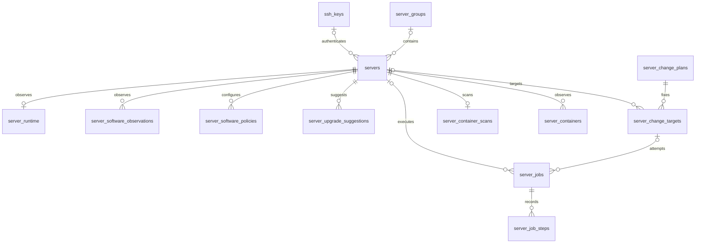

# 服务器管理 V2 数据模型与插件契约

状态：2026-10-19 详细设计基线。本文将已确认需求落实为字段、关联、接口和执行规则；A1 已实施配置／观察分离与系统登记，见 [实施记录](database-redesign.md#7-a1-实施记录2026-10-19)；完整 V2 契约和任务／计划仍待后续。设计附件为 [DDL](schema-v2.sql) 和 [TypeScript 契约](plugin-contract-v2.ts)，两者只在本文目录内验证，不属于插件公开导出。

前置依据：[数据库问题](database-redesign.md)、[类型与升级](group-types-and-i18n.md)、[操作系统](operating-systems.md)、[实例列表](server-instances-list.md)。此前文档的产品规则继续有效；本文替代旧表名、局部软件 ID、`registerGroup()` 及混合任务结构的实现建议。已有代码仍使用扩展了系统范围的 `registerGroup()`；不能把下面的完整 V2 设计当成当前可调用能力。

## 1. 本阶段确定的边界

1. 登记配置、远端观察、用户策略、升级建议、确认计划、执行记录分别存储。主表不再增加 Docker、Compose 等专用列。
2. 软件身份跨分组稳定，安装配方按操作系统／架构选择。类型是插件提供的规则，数据库保存绑定与快照，不复制一套可独立修改的类型定义。
3. 安装、移组、升级共享计划与任务基础。软件修改成功并验证后才提交需要软件处理的移动；失败保留原绑定并报告远端变化。
4. 自动检测只产生建议。用户确认的版本、机器、依赖、时间与影响被冻结，执行时不再解释成最新版。
5. 无服务器数据、无发布兼容要求，因此不保留旧服务器回填、旧接口别名或旧字段双写。保留现有分组和密钥，不能据此清空整个平台。

## 2. 表、关联及字段职责

DDL 共 13 张表，覆盖完整路线；不是要求下一次编码一次上线全部升级功能。A 为重构现有基础所需，C 为版本／移动阶段扩展，D 为升级管理阶段启用。B 为列表与系统筛选，不另建状态表。

| 表 | 阶段 | 主键／关系 | 字段职责 |
| --- | --- | --- | --- |
| `server_groups` | A | UUID；系统 `(plugin_id, group_key)` 唯一 | 来源、中英名称、排序、定义快照与修订。用户名称另作唯一约束；系统分组不同插件可同名。 |
| `ssh_keys` | A | UUID；指纹唯一 | 名称、加密私钥。保留现有独立密钥管理，不能从计划快照读取私钥。 |
| `servers` | A | UUID；`(host, ssh_port)` 唯一；可空 `group_id` | 名称、地址、SSH 认证、主机指纹、地区、类型键／快照／修订、声明系统、安装选择、配置修订。`group_id=NULL` 表示服务器模块的未分组，与工作区组无关。 |
| `server_runtime` | A | `server_id` 一对一 | 最新连接结果、系统探测、环境修订、资源采样及各自时间／错误。不是资源历史时序表。 |
| `server_software_observations` | A | `(server_id, software_key)` | 每项软件本次检测、上次有效事实、产品版本、原始包列表、健康结果、所用配方与修订。 |
| `server_software_policies` | C、D | `(server_id, software_key)` | C 接入用户收紧范围；D 接入逐项自动检测、调度及推迟提醒。与实际安装状态分开。 |
| `server_upgrade_suggestions` | D | UUID；`(server_id, software_key, target_identity)` 唯一 | 具体目标、候选有效性、用户拒绝、生成依据与发现时间。 |
| `server_change_plans` | A 基础，C、D 扩展 | UUID | 操作目的、固定请求、确认摘要、确认者、预约窗口、并发数和失败暂停规则。A 仅承接补齐软件的准备计划。 |
| `server_change_targets` | A 基础，C、D 扩展 | UUID；计划内服务器唯一 | 每台服务器的预期修订、原／目标绑定、精确软件动作与结果。 |
| `server_jobs` | A | UUID；关联目标或只读检查请求 | 一次执行尝试、领取租约、阶段、幂等键、远端操作 ID、执行结果。替换 `ops_jobs`。 |
| `server_job_steps` | A | UUID；`(job_id, ordinal)` 唯一 | 连接、预检、逐软件动作、验证、提交的前后事实和实际变化。 |
| `server_container_scans` | A | `server_id` 一对一 | 可选容器观察的本次结果与上次成功时间，区分“成功且 0 个”与“本次不可用”。 |
| `server_containers` | A | UUID；`(server_id, container_id)` 唯一 | 最近一次成功取得的容器明细，仅用于相关详情，不参与所有实例的列表查询。 |



### 2.1 关系字段与 JSONB 的边界

主键、外键、调度时间、任务阶段、用户决定、软件身份和常用筛选值独立成列。国际化、声明／实际系统对象、原始包集合、版本规则、冻结计划和结构化错误使用 JSONB。JSONB 不是逃避字段设计：其格式由契约及进程边界解析器确定，数据库只负责对象／数组形状等基础约束。业务代码不得任意写入另一种对象格式。

所有时间用 `timestamptz`。预约另存用户选择的 IANA 时区供展示与审计，执行使用确认时解析的绝对起止时间。UUID 由宿主产生。`bigint` 修订及字节数通过 JSON 返回字符串，避免浏览器整数精度丢失。

认证只允许一种来源：密码登录保存服务器自己的密文；私钥登录引用 `ssh_keys`，服务器密文为空。地址由宿主规范化后参与唯一约束，但不靠临时 DNS 解析把不同名称自动合并。同一地址与端口仍沿用现有唯一登记规则。

### 2.2 类型与软件不建可写的定义主表

类型、操作系统目录、软件和配方来自当前注册表。服务器的 `type_snapshot` 保存登记时可展示的名称和规则；系统分组的 `definition_snapshot` 保存来源与展示定义；计划再冻结它实际使用的规则。快照不含密钥或脚本内容，不能用于插件卸载后的新执行。

插件失效时保留名称、原类型和服务器归属，返回 `available=false`，不静默改成空置。重新加载相同身份恢复原分组 UUID；规则变了重新判断兼容性，不能自动升级软件。注册表的可用性是当前进程事实，不通过数据库的永久 `enabled=true` 模拟。

### 2.3 观察失败不覆盖真实历史

例如上次检测 Docker 为 `27.3.1`，本次 SSH 检测失败：`probe_state=unknown`，更新检查时间和错误；保留 `last_known_state=installed`、版本和 `last_success_at`。页面可展示“上次检测 27.3.1，本次未知”，但预检不能把上次结果当作本次成功，更不能按缺失触发安装。

移为空置或另一类型后，不删除实际软件观察、不伪造卸载。当前必要项从当前类型计算。已不再需要的软件策略停止调度并移除；以后重新成为必要项时检测开关按新增项默认关闭。升级建议保留并标为过期，拒绝身份不因移组或重复扫描被擦除。容器检测失败也保留上次成功明细，并由 `server_container_scans` 说明其时效。

### 2.4 删除与引用

- 系统分组删除由业务接口拒绝；用户分组删除先校验全部成员的目标类型并事务性改为未分组，再删除。外键用 `RESTRICT`，不能靠 `SET NULL` 绕过转换规则。
- 密钥在被引用时不可删除；替换其内容应创建新密钥身份并更新服务器引用，避免引用不变而旧计划继续使用新凭据。
- 删除服务器前锁定该服务器，拒绝正在执行或恢复中的任务，取消尚未执行的目标／排队任务。删除登记及其观察、策略和建议；历史目标／任务的 `server_id` 置空，保留不可变 `server_identity` 和不含凭据的名称／地址快照。
- 计划及目标作为审计记录，不因删除服务器级联消失。当前没有“清理历史计划”功能；未来如提供，应单独定义保留规则。

## 3. 操作系统与软件身份

### 3.1 系统登记和探测

`DeclaredOs` 保存目录项的稳定大类键、版本、精度与条目键，或 `custom` 原文。目录项例如 `builtin/ubuntu`，不是展示字符串；`release` 表示特定发行版本，`series` 表示已确认的版本系列。原文不能被脚本执行器拼进命令。

插件支持“其他”时注册精确别名到已知系统条目的映射及只读识别能力；保留用户原文。实际探测必须证实该身份，不能只靠别名就授权安装。无映射时只能选择空置；有映射但未验证时只能保存，不能执行软件变更。未验证不等同于不匹配：前者提示检查，后者要求更正登记；二者都不授权软件修改。

`server_runtime.detected_os` 保存实际身份、具体版本、架构及非敏感原始识别值。探测失败保留上次有效值，但 `os_probe_state=failed`。`matched/mismatch/unverified` 根据最新探测、声明系统及目录规则计算，不与登记配置混写。系统不匹配时阻止安装、移动、改类型及升级，允许修正登记系统。仅改名称等不相关信息仍可保存。

类型、条件必要项、配方分别声明系统范围。没有隐式“所有 Linux 都可执行”；普通类型只列入配方已经验证的 Linux 范围。目录中的 Windows 版本可登记空置，不能触发现有 `sh`、`/proc` 命令。类型默认值不适用时使用分组明确声明的系统默认值；仍无默认则要求从适用项选择，无适用项则阻止登记／移入，不能插入分组未提供的类型。

### 3.2 稳定软件键与配方键

所有定义使用 `builtin/<key>` 或 `<插件包名>/<局部键>`，例如软件 `builtin/docker-engine` 与配方 `builtin/docker-ubuntu-apt`。同一真实软件由一个提供者拥有稳定身份；其他插件引用该键并提供自己的配方或类型要求。仅中英名称相同不会自动合并；不同配方也不会自动产生新的软件身份。注册必须拒绝重复拥有同一个键。

跨组比较按软件键找实际观察，再按版本范围和目标配方检查。配方提供者、脚本摘要、目标系统、架构和实际包不同都属于预检输入。更换包来源／安装方式可能要求替换，即使软件版本数字相同也不能直接视为安全保持。同一个软件在同一目标系统／架构若有多种允许配方，先保留仍适用且满足要求的当前配方，否则按类型显式列出的配方顺序选择；选择结果必须进入预检快照，执行时不能重新选择。

## 4. 插件注册与执行协议

契约详见 [plugin-contract-v2.ts](plugin-contract-v2.ts)。新服务方法为 `ctx.serverManagement.registerDefinitions(bundle)`，一次声明操作系统、软件、配方、类型和分组，返回 `{ ready, dispose }`。旧 `registerGroup()` 在切换实现时移除；本稿尚未增加运行时方法。

```ts
export const inject = ['serverManagement']

export async function apply(ctx: Context) {
  const registration = ctx.serverManagement.registerDefinitions({
    contractVersion: 2,
    owner: '@example/compute',
    groups: [{ key: 'compute', name: { zh: '计算节点', en: 'Compute nodes' } }],
  })
  await registration.ready
}
```

示例省略类型时继承两种内置类型，并继续按系统过滤。宿主用贡献者上下文登记 effect，插件不用手工追加第二个卸载监听。调用者和宿主都不建立模块级可变注册单例。采用仓库 [dsh 插件规范](../../../.agents/skills/dsh-plugin/SKILL.md) 与 [生命周期规范](../../../.agents/skills/dsh-plugin/lifecycle.md)。

### 4.1 原子发布与依赖

先解析定义与引用、校验语义，再读取脚本、计算修订、持久化分组展示快照，最后原子发布注册表。任一步失败均不发布半套可用定义。新分组缓存即使因异常保留，也只能展示为不可用。结构类型已经保证的同进程参数不重复作格式校验；仍须校验重复身份、未知引用、空类型列表、默认项、循环依赖、版本空交集和系统支持交集等业务不变量。

跨插件引用的提供者必须已注册，不能凭加载列表顺序猜测。提供者卸载后，依赖它的类型／配方也立即停止接受新执行；已接受任务持有完整依赖的租用引用。先停止新任务，等待已开始的软件修改、验证及最后持久化结束，再释放脚本和注册。宿主数据库、任务执行器、定时器与服务发布采用有序 effect；`ctx.provide()` 最后发布。

脚本在注册时读取为不可变内容，并连同语义定义计算宿主修订。修订包含系统条件、版本适配器版本及其提供者代码版本、依赖、能力和脚本内容；名称翻译、图标、排序等纯展示变化不使执行确认失效。不能只相信插件填的版本字符串，也不能仅按文件路径判断脚本没变。

### 4.2 配方能力

| 操作 | 副作用约束 | 输入／输出 |
| --- | --- | --- |
| `detect` | 只读 | 实际 `installed/missing/unknown`；产品版本、包版本、目标身份及健康结果。 |
| `list-candidates` | 只读 | 实际包源中的候选，保留产品版本与原始包身份。默认仅稳定版本。 |
| `resolve` | 只读 | 指定候选的精确包、依赖、服务影响和非敏感执行参数。 |
| `execute` | 按已确认动作修改 | 仅执行冻结的安装／升级／替换；不允许无约束整机包升级。 |
| `verify` | 只读 | 重新检测实际版本及必要健康检查，不能仅看安装退出码。 |
| `recover` | 只读核对 | 依据远端操作 ID 返回未开始、仍运行、完成、失败或未知，以及已知实际变化。 |

配方可只有检测能力；这种配方不能被当作安装配方使用。声明变更能力时必须同时提供精确解析、执行、验证及恢复能力。初装也解析具体目标；旧的 `install.sh` 不经适配不能假装支持固定版本。静态依赖在注册时检查，源中发现的附加依赖在预检时递归解析，检测循环／冲突，整个依赖图冻结后才能确认。

脚本以受支持的解释器运行，通过 stdin 传 JSON；stdout 为有界的协议 JSON，日志走独立的有界通道。非零退出、超时、JSON 无效或缺字段是带稳定码的失败／未知，不降格成缺失。执行器对网络、进程、持久化边界作解析，脱敏后保存日志。配方只能来自当前注册，页面和会话工具不能提交任意脚本路径。系统识别脚本另用 `OsProbeRequest/OsProbeResponse`，只读返回系统身份或未知，不能套用某项软件的检测输出。

包源临时失败是该次检测／预检失败，不让整个分组注册失败。实际执行之前再次核对源、精确包可取得性、系统、架构和脚本修订，不允许找不到目标时回退到其他版本。

### 4.3 版本与候选身份

`VersionRule` 保留 `any/exact/series/minimum/range` 五种模式。软件 SemVer 与系统版本分开运算；非 SemVer 软件必须提供完整的比较、范围交集、子集及上限判定能力，不作宽松字符串转换。用户条件除 `any` 表示继承外，须是类型有效范围的子集，越界或空交集拒绝保存。

`27`、`27.3` 是系列；`27.3.1` 才是完整固定版本。区间的部分上界包含整个系列，完整上界含端点。原始包版本保存 epoch、发行修订等，不能将它截断成产品版本。统一升级版本按产品版本求交集，每个目标仍有自己的系统包清单。

`target_identity` 由软件适配器规范化产品版本和有意义的包修订。镜像 URL、检测时间不参与拒绝身份；换镜像不能重新提醒同一版本。同一产品版本下真的出现新包修订可成为不同目标，但完整固定版本／达到配置上限时不生成周期升级建议，不能用包修订绕过用户锁定。显式修复／重装属于另一次确认操作。

## 5. 修订、事务与任务执行

### 5.1 三类修订

| 修订 | 增加／变化条件 | 不受其影响的变化 |
| --- | --- | --- |
| `config_revision` | 地址、用户、认证、主机指纹、声明系统、分组、类型、安装选择、有效版本限制 | 名称、地区、语言、指标采样、推迟／拒绝、检测开关与调度时间 |
| `environment_revision` | 最近成功识别的实际系统身份、具体版本或架构变化 | 相同结果重复探测、连接检查时间、CPU 等指标 |
| `definition_revision` | 使用到的类型／软件／配方的执行语义及内容变化 | 中英文标题、排序、图标 |

逐软件 `policy_revision` 标识该策略的用户修改；版本限制变化同时提升服务器配置修订，检测开关变化不使已确认升级失效。计划还冻结实际软件状态／包身份；不能仅靠三类修订判断远端没有漂移。执行前做新鲜的只读预检并逐项比较，检测到已达目标则记录无需执行，发现未确认的其他变化则阻塞。

持有服务器任务期间，接口禁止修改会影响计划的关键配置；名称等展示字段可更新。最终写绑定使用 `WHERE id=? AND config_revision=?` 的条件更新。失败不覆盖用户后来保存的配置，也不宣称远端已回滚。

### 5.2 计划生命周期

`draft → awaiting_confirmation → scheduled → running → completed/partial_failure`；可进入 `blocked/paused/cancelled/missed`。状态表示计划整体调度情况，单台结果另存；暂停期间必须仍能显示正在收尾的任务数。

预检不跨用户思考时间持有数据库事务或 SSH 连接。服务端保存固定服务器 UUID、源／目标绑定、修订、全部软件动作与依赖，再计算规范化内容摘要。摘要也覆盖服务影响、执行窗口、并发与暂停策略；改变这些内容必须先更新草稿修订，不能在确认接口里悄悄追加新时间。确认用计划修订与摘要作条件更新；确认者由宿主当前登录上下文取得，不能信任页面传入的用户名。

已确认内容不可原地更改。改变机器、版本、依赖或时间须生成新的预检／确认版本，旧执行记录保留。改期也重新确认窗口。暂停后如目标和修订完全未变，可由用户明确恢复；若发生变化，建立后续计划并重新确认。失败目标的重试保留旧任务，增加 `attempt`，重新预检；不能让定时器无限重跑软件变更。

计划有两种授权来源：

- `explicit`：用户确认列出的移动、替换或升级计划；所有升级，包括补丁和小版本，都属于此类。
- `missing_software_only`：登记／编辑中保存“安装必要软件”的选择，对当前类型缺失软件的有限授权。只允许 `prepare` 的 `keep/install`，仍需预检和精确解析；一旦发现已安装但不合规、需要替换／升级／额外非必要变更，就转待确认，不能沿用开关执行。

关闭安装开关时，缺软件可按既定产品规则只保存登记或移动并标待安装；计划中明确记作 `defer-install`。已有冲突仍必须明确同意替换，否则取消这次移动。转为空置保留远端软件。安装开关不是“当前是否安装成功”的事实。

### 5.3 领取、远端互斥与恢复

每次尝试一个 `server_jobs`，`purpose` 区分只读检查、升级检测、执行计划。任务阶段至少包含连接、预检、安装、替换、升级、验证、提交、恢复。只读连接测试不再夹带安装；需要补齐软件时创建关联的准备计划和独立执行任务。

领取在事务中锁定候选任务和服务器，采用 `FOR UPDATE SKIP LOCKED`。同服务器 `claimed/running/recovering` 的部分唯一索引作最后防线；并发争用后重新选取，不能将唯一冲突误报为服务器故障。申请计划并发名额与领取必须同事务锁定计划，避免并发启动超额。

工作进程保存租约与递增 fencing token。心跳、阶段和结果写入均核对持有者与 token。租约过期先转恢复，不能直接再执行；数据库 token 只能阻止旧执行者写库，**不能阻止已经送到远端的包操作**。远端必须另有每服务器互斥、操作 ID 和结果记录，持锁期间不能重复启动。一个任务的多个软件步骤共享任务操作 ID，各步骤再以固定序号／软件键记录执行结果，不能让第二项软件误读第一项的完成标记。恢复未知时保持服务器恢复锁并提示人工核对；不能把其改为普通失败后让其他修改绕过。

取消／卸载停止领取和未开始任务；已开始包操作有序完成必要步骤、验证并写结果。控制进程异常退出后先核对远端操作与包管理器状态，不因本地 `running` 标记就认定远端失败或安全重试。一次任务包含多个软件时按依赖顺序记录步骤；中途失败保留所有已发生的变化。

批量任务有一台失败时，写失败和暂停计划在同一调度锁下完成，尚未开始的目标停止领取，已开始的工作有序结束。恢复检查不得清掉这次暂停。窗口过期且未开始的目标标记错过／阻塞，不能恢复控制端后补升级；已在窗口内开始的包操作不因窗口结束被强杀。

### 5.4 关键事务边界

| 操作 | 同一数据库事务内 | 事务外 |
| --- | --- | --- |
| 登记／关键编辑 | 配置、当前必要软件策略、修订、旧待执行计划失效；创建运行观察初始行 | 系统与软件检查 |
| 确认计划 | 条件更新计划修订、摘要、确认者、窗口；冻结目标快照 | 不执行 SSH |
| 领取／恢复 | 计划与服务器锁、任务状态、租约、token | 远端检查或执行 |
| 完成移动 | 再核对修订，更新分组／类型及策略，增加修订，记录目标／任务成功 | 此前已经完成的远端修改无法由事务回滚 |
| 单机失败 | 保存失败与已知实际结果、暂停所属计划 | 必要的只读恢复检查 |

SQL 约束不能代替跨表授权：目标必须属于该计划和服务器、任务必须引用已确认且未过期的目标、计划冻结后不可写入新机器，这些由服务事务验证。接口幂等键只去重同一请求；相同键携带不同请求体必须报冲突，不能返回另一请求的成功结果。

## 6. 升级建议和用户处理

用户偏好 `detect_updates` 与调度资格分开。固定版本、达到完整上限、缺少配方、软件未安装或类型失效时不派周期候选检测，`next_check_at=NULL` 并返回原因；保留原开关供条件变化后重算。当前只是包源最新时仍安排下一次检测。控制端停机错过的检测合并为一次，使用任务幂等键避免多进程重复补发。

候选有效性与用户决定为独立字段。检测更新 `validity/candidate_snapshot/basis_snapshot/last_seen_at` 时不得覆盖 `decision`。拒绝只作用于该服务器该软件该目标，可撤销；更高目标仍可提醒。`reminder_after` 按服务器／软件保存推迟时间，到期只恢复提醒。软件升级计划必须通过单独的确认接口生成，推迟接口没有安排执行的参数。

“已安排”由非终结计划的目标快照关联计算，不靠把建议改成一个容易滞后的 `scheduled` 字符串。筛选区分可处理、推迟、拒绝、已安排、检测失败；批量选择最终展开成固定 UUID 清单，再按各台系统、架构、约束和配方求共同版本。确认后筛选结果变化不增添机器。

## 7. 列表聚合与 API 边界

返回契约见 `ServerListItem`。八列为名称、地址、操作系统、类型、状态、是否安装必要软件、资源概览、最近检查。页面只翻译状态码和原因，不自行从 Docker 或任务日志推导状态。

安装列返回保存的 `enabled` 及 `applicability`：必要项为空时显示不适用，非空显示是／否；类型提供者失效时显示不可判定并保留设置。实际软件符合结果属于详情及统一状态输入，不能冒充该列布尔值。

### 7.1 唯一状态算法

按以下优先级取得主状态，同时保留所有相关原因；“正常”必须有证据，缺失不默认为正常。

1. 活跃任务确实处于升级及其后续验证／提交阶段：`upgrading`。安装／替换及其验证阶段：`installing`，原因说明实际操作。不能仅因为整个计划已安排就显示执行中；进入变更阶段后记录 `mutation_phase`，验证阶段不丢失上下文。
2. 恢复中且远端确认仍在执行时沿用对应执行状态；远端状态未知则 `attention`，说明待核对，不能误显示正常或已失败。
3. 最新连接检查失败且没有上述有效执行：`disconnected`，附带认证、指纹或网络错误原因。
4. 系统不匹配、必要软件缺失／冲突／健康失败、类型或配方失效等当前未解决问题：`attention`。
5. 尚无成功连接／系统核对，或必要软件本次结果未知、已过期：`unverified`，说明待验证的项目。
6. 系统核对成功，连接正常，当前必要软件符合或为空：`normal`。

仅历史任务失败、资源采样短暂失败、已有升级建议不永久压成需处理；返回附属原因及采样时间。资源时效不能改变连接事实。最近检查列用 `connection_checked_at`，资源另外显示 `metrics_sampled_at`；类型／软件最新事实仍要校验采集依据，不能以指标更新时间代表整个服务器检查完成。

### 7.2 查询与分页

避免一对多表直接平铺联接。一次捕获注册表版本，按集合读取登记／运行数据、当前必要软件观察、活跃任务和升级摘要，每类先按服务器归并；容器明细不进入主列表。一次请求使用一致数据库快照，整个请求只使用同一份定义集合，保证一台一行和计数一致。

首版不在数据库复制插件的版本比较器，也不增加可写的“总状态”字段：普通分组／文本筛选和排序可直接在 SQL 分页，再批量取本页关联事实；涉及计算状态或升级条件的筛选，后端必须先对整个候选集合批量计算、过滤，再计数分页。后一条仍有随候选规模增长的计算成本，应作为明确的首版性能限制；不能只筛当前页，也不能把全量明细发给浏览器再分页。

如后续容量验证需要优化，增加带配置／环境／定义／观察修订的可重建查询投影，再在投影上做 SQL 条件分页；现在不让它变成第二套事实来源。客户端改为提交分组、搜索、页码和页大小，配置变化后刷新；任务进度与资源摘要按需要更新，取消当前每秒全量读取服务器与分组的方式。

API 分工确定为：目录／分组／适用类型查询，登记及普通编辑，只读检查，计划预检，计划确认，暂停／取消／显式恢复，升级建议处理。分组／类型等需预检的编辑由普通编辑接口返回稳定码 `change_plan_required`，不能偷偷转换为直写。操作系统纠正有独立校验路径，不能因旧的不匹配把纠正本身锁死。所有入口（页面、后续会话工具）共用同一服务逻辑。

## 8. 开发库切换方案

设计稿不会自动执行。实施时采用新的模块迁移文件，例如 `0013_server_model_v2.sql`，不要仅改已记录的 `0010/0012` 并期待自动重跑。当前没有服务器数据，可以明确重建空的 `servers/server_containers/ops_jobs` 等模块表，同时保留 `server_groups` 的 UUID、系统身份与用户分组，以及 `ssh_keys` 内容；相应约束／列通过新迁移调整。

迁移在事务中验证待重建表为空；意外发现数据就报错停止，不能静默 `CASCADE` 删除。服务升级前停任务／采样写入；数据库升级后只启动新代码。不得修改会话、工作区、平台设置等其他模块数据或删除全库迁移记录。新数据库允许顺序应用既有初始化再执行本次重构，以便已有迁移执行器可确定地到达相同终态；这不是保留旧服务器兼容层。

DDL 附件用于表达完整终态，新迁移按阶段抽取当前所需部分。以后新增 D 阶段表用新的迁移文件，不提前放出不可工作的升级接口。旧字段、旧 `ops_jobs`、旧 `registerGroup()`、旧文本 JSON 在完成切换后删除；需要同步改写本插件测试替身和提供者示例。

## 9. 实施顺序与验收

| 阶段 | 交付范围 | 验收重点 |
| --- | --- | --- |
| 本次：详细设计 | 本文、DDL、V2 契约 | 类型稿可检查，DDL 可在隔离 schema 初始化，关键唯一／外键／状态约束能拒绝非法记录；不宣称功能完成。 |
| A：基础重构与系统登记 | 配置／观察分离、逐软件事实、V2 注册、操作系统两行选择与只读识别、任务阶段／互斥；适配现有必要软件准备流程 | 全新初始化、空表重建保留分组与密钥；现有登记、终端、采样和插件卸载可用；Windows 空置路径不跑 Linux 命令；未知不安装；已开始任务不重复执行。 |
| B：系统范围与新列表 | 类型／软件系统过滤、八列、后端筛选分页、统一状态 | 未支持系统不安装；系统纠正不被锁住；状态筛选跨页准确，一台一行，指标刷新不增加配置修订。 |
| C：版本及移动 | 用户收紧范围、候选精确解析、冲突预检、一次确认、成功后提交绑定 | 版本边界／依赖冲突、拒绝不移动、关闭安装时的待安装移动、部分失败保留原绑定及真实远端变化。 |
| D：升级管理 | 策略调度、建议处理、独立 Tab、批量计划、预约及恢复 | 只检测不执行，拒绝不重复提醒，推迟不执行，统一版本与固定目标，失败暂停、错过不补升级、失联先恢复。 |
| E：会话工具 | 按新契约接入目录及 shell 权限 | 同一服务校验，默认无会话访问，权限与审批规则按专门文档实施。 |

A 阶段分两步交付：A1 为配置／观察和系统登记，A2 为 V2 注册、计划和任务执行器。A1 保留的现有初装脚本只是尚待替换的旧能力，不代表已实现 V2。A2 适配当前安装能力时必须冻结初装包、记录阶段与恢复信息；不能为了把版本 UI 延到 C 就继续执行不受控的安装最新版脚本。C 再扩展范围编辑、替换与移动的完整交互。各阶段完成后更新实际进度，不把定义了未来状态码等同于上线了升级管理。

## 10. 本次设计验证记录

2026-10-19 验证：

- `tsc --noEmit --strict --target ES2022 --module NodeNext --moduleResolution NodeNext --skipLibCheck docs/design/server-management/plugin-contract-v2.ts` 通过。
- 在随机新建的 PostgreSQL schema 执行完整 DDL，13 张表初始化成功；25 项结构检查通过，包括凭据互斥、系统分组身份、外键保护、未知观察保留、拒绝目标身份、确认／时间窗约束、幂等键、活跃任务互斥、恢复期间继续占用执行权，以及删除登记后保留历史身份。
- 验证数据全部在隔离 schema 内，完成后删除该 schema；未重建或改写当前应用表，也未连接真实服务器执行安装。

这些检查验证类型稿与数据库约束，不代表 SSH 恢复协议、插件生命周期、列表聚合或升级业务已经实现。跨表授权和远端互斥仍需在 A～D 阶段使用服务事务及执行测试验证。
