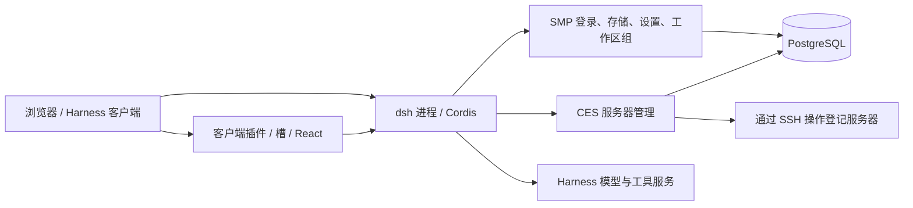

# 架构总览

核对基线：`ces/develop`，`f2b8d86`，2026-10-20。

## 系统组成

CES（Cyber Evolving System）构建在 SMP（Smart Management Platform）基座之上。这个仓库是一组由 DeepSeek Harness（dsh）加载的 Cordis 插件及一个界面共享包，不是独立的 Node Web 服务。插件的 `engines.dsh` 当前钉在 `0.2.1-alpha.5`。

`dsh` 提供 Web 入口、连接认证、会话／代理、工作区注册、存储协议、设置、模型、客户端服务和槽机制。仓库插件通过 `inject` 使用它们，不自行替代宿主启动程序。

PostgreSQL、模型服务和登记服务器是外部资源。服务器管理的控制端调度在 dsh 进程中；远端软件变更使用 SSH 启动的持久操作日志和监督进程，不是另一个 CES 常驻 Agent。

## 宿主与客户端

| 层 | 职责 | 入口 |
| --- | --- | --- |
| 宿主插件 | 路由、数据库业务、SSH、定时调度和服务注册 | `plugins/<name>/src/index.ts` |
| 客户端插件 | 页面、槽登记、局部视图状态、主题和语言 | 有页面插件的 `src/client.tsx` |
| 共享 UI | 面板与通用样式，不持有业务连接 | `packages/console-kit` |
| dsh profile | 组合实际加载的包、patch、配置和凭据 | 仓库外／忽略的运行目录 |
| 构建产物 | 交给 dsh 的宿主和浏览器模块 | 插件 `lib/`，不提交 |

HTTP 接口以 `/console-api` 为主；Harness 自己的 RPC／资源能力继续属于宿主，不能把其 `/api` 当作本项目业务路由空间。

客户端 React 使用 Harness 提供的实例。页面由已有槽渲染，服务器管理等业务插件不接管文档根；frame 负责应用壳与导航。工作区组通过适配原生侧栏数据和工作区选择流程实现筛选，保留原生会话交互。

## 状态分层

- 持久配置和执行事实写入 PostgreSQL；不能把页面状态当作任务执行授权。
- 服务实例、注册目录、租约、调度器和连接由单次 Cordis `apply` 拥有。
- 当前页面、筛选、弹窗等由对应客户端实例／组件拥有；退出和卸载要释放监听及请求。
- 模型设置的权威入口仍是 Harness，数据库保存同步镜像。
- 工作区目录归属与服务器分组是两套不同业务，二者没有隐式关联。

## 当前边界

仓库当前没有旧设计中的交易所、量化、钱包管理、资金账户等业务插件。frame 保留针对旧 `wallets` 表的密码重加密逻辑，不能据此推断完整钱包模块已经交付。

服务器管理仍内置空置／普通类型以及 Docker／Compose 能力。详情工作区（含独立任务、终端、容器、配置面板）已实现；独立容器插件、类型专属面板和自定义配置栏目属于[待实施工作](../handoff/status-and-roadmap.md)。

当前数据库基线依赖既有 SMP 表结构；仓库迁移不完整创建 `accounts` 和 `wallets`。因此 `npm install` 加安装页不能视为完整的新机器空库部署方案，见[运行前置条件](../operations/configuration-and-startup.md)。

## 源码入口

- [根 package.json](../../../package.json)、[构建脚本](../../../scripts/build-plugin.mjs)。
- [frame 宿主](../../../plugins/frame/src/index.ts)、[frame 客户端](../../../plugins/frame/src/client.tsx)。
- [数据库](../../../plugins/database/src/index.ts)、[服务器管理宿主](../../../plugins/server-management/src/index.ts)。
- [插件地图](plugin-map.md)列出当前全部插件及注入依赖。
