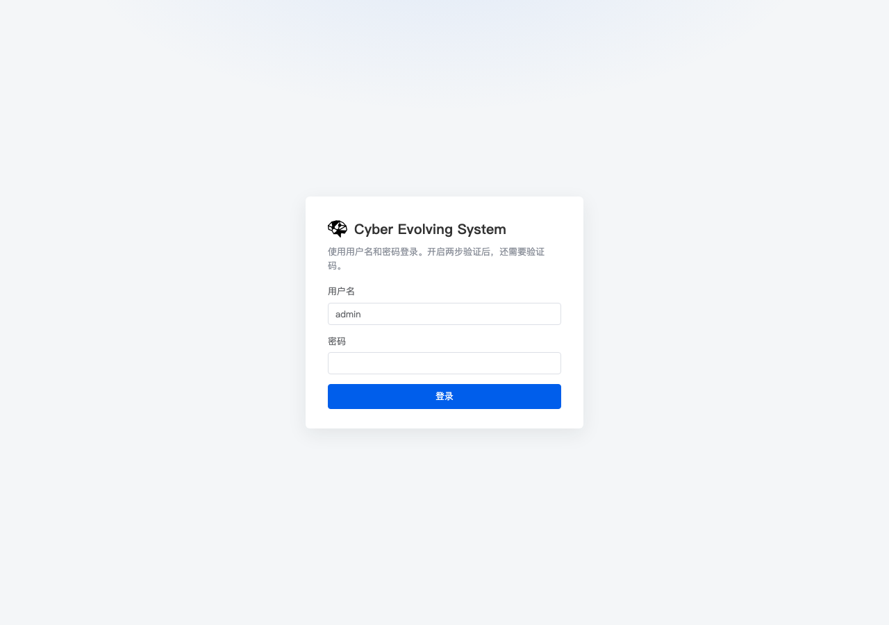
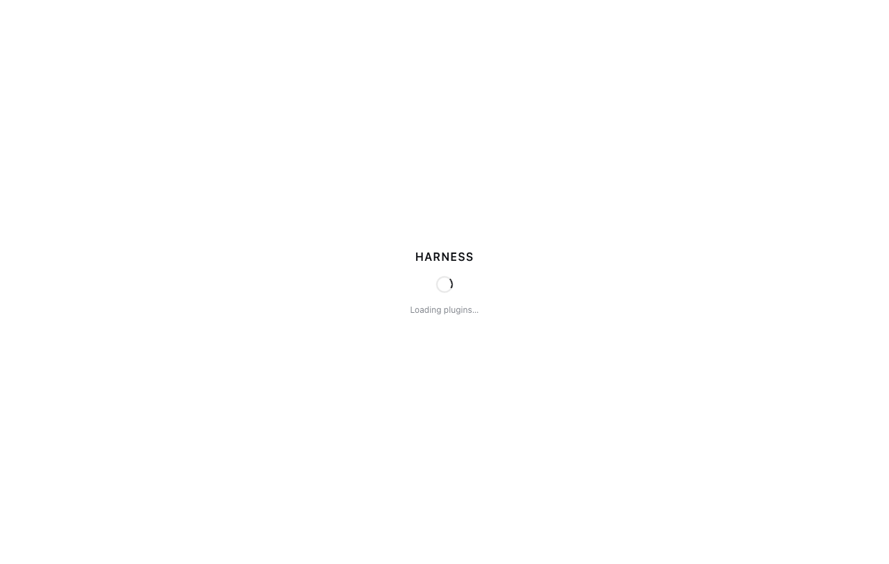

# 浏览器登录重定向循环修复（2026-10-25）

## 1. 现象

B/C 的登录页正常，但登录成功后浏览器报：

```text
ERR_TOO_MANY_REDIRECTS
```

用 curl 复现：

```text
登录 → 200
GET / → 303 Location: ./
      Set-Cookie: dsh-auth-...（每次都重新签发）
GET / → 仍 303 + 新 dsh-auth
```

## 2. 根因

dsh 的 `authorizeIndex` 前面有 `@smp/console-frame` 的 gate：

```text
signedIn = smp_session 有效
dshAdmitted = connection.admit(request) 没有 rejection
if signedIn && !dshAdmitted → mint dsh-auth cookie
```

`connection.admit` 会执行 Host/Origin 信任检查。容器的 dsh 监听地址是
`172.18.0.4`，而请求 Host 是公网 IP `43.163.113.98` / `43.153.204.197`。
entrypoint 支持 `TRUSTED_HOST`，但 candidate.env/prod.env 没有设置它，因此
Host 永远不被信任：

```text
admit → rejection
→ gate 每次都 mint 新 cookie
→ 浏览器无限重定向
```

登录 API 不经过这个 gate，所以 API 登录一直正常。

## 3. 修复

1. 在 `/srv/ces-test/secrets/public-host` 和
   `/srv/ces-prod/secrets/public-host` 写入公网 IP。
2. `test.sh`/`host.sh` 生成 candidate.env/prod.env 时写入：

```text
TRUSTED_HOST=<公网 IP>
```

3. 重新创建容器（环境变量在容器启动时读取，`docker restart` 不会更新）。
4. Caddyfile 增加压缩，降低首次加载大 JS 的传输时间：

```text
encode zstd gzip
```

## 4. 验证

B：

```text
GET / → 303，Set-Cookie dsh-auth
GET /（带 cookie）→ 200 text/html
```

C：

```text
GET / → 303，Set-Cookie dsh-auth
GET /（带 cookie）→ 200 text/html
```

不再出现连续 303 + 反复 Set-Cookie。登录页截图正常；受跨境网络影响，
首次加载前端 bundle 较慢，压缩后主包从约 3 MB 级降到约 320 KB 传输。

## 5. 后续

- 入口仍应优先使用浏览器实际访问的域名/IP；换公网 IP 时要同步更新
  `public-host` 并重建容器。
- 如需彻底消除首次加载慢，可把静态资源放到 CDN 或更近的 Caddy。


## 6. 登录页截图

B：


C：



两张截图由 headless Chrome 直接访问 `/login` 生成。


## 7. 登录后页面

B 的 headless Chrome 在跨境网络下约 36 秒后出现应用外壳：



页面显示 `HARNESS / Loading plugins…`，说明登录、dsh-auth cookie 和前端入口
已通过；后续插件 bundle 仍受跨境网络带宽影响。
