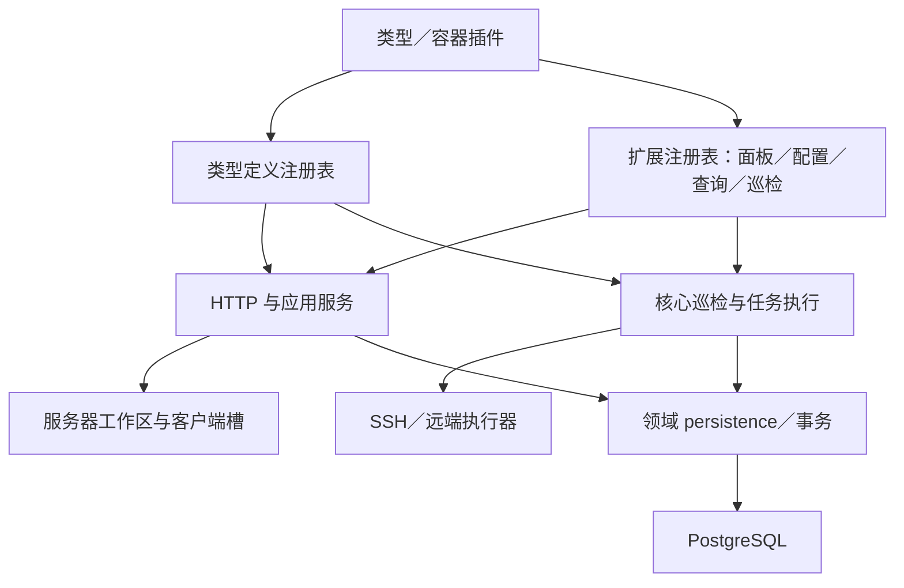

# 架构评价与取舍

本文件针对提交 `610497f`。链接指向当前仓库相应文件；具体问题的行号和证据在 [findings.md](findings.md)。

## 1. 八步成果与设计评价

| 步骤 | 当前交付 | 设计评价 |
| --- | --- | --- |
| 1 详情工作区 | 详情、任务、终端、配置及插件面板有统一入口 | 工作区作为服务器级状态边界合理；任务查询状态独立保存 |
| 2 终端生命周期 | 同服务器切换面板保留终端，退出和身份变化释放／重建 | 资源归属与用户操作匹配，优于把连接绑定到某次 tab 挂载 |
| 3 内置配置 | 基础配置、软件策略复用已有服务规则 | 避免复制安装和移组逻辑；扩展栏目异步加载还需与基础资源处理对齐 |
| 4 公共类型与契约 | owner、稳定 key、版本、类型和系统作用域 | 具备可扩展基础；源码导出与可供独立插件使用的发行接口尚有距离 |
| 5 面板和配置 | 宿主目录、客户端槽、API、配置持久化、错误边界 | 服务端校验适用范围，隔离组件错误；配置计划未绑定提供者版本 |
| 6 扩展巡检 | 复用核心 SSH、队列、任务与观察表 | 避免插件各建定时器和连接；注册身份和配置修订未贯穿最后提交 |
| 7 容器插件 | 类型、配方、面板、配置、清单巡检及查询独立注册 | 已实现功能插件化；资源和源码依赖仍需收拢 |
| 8 验收 | 实机、浏览器、故障注入及最终清理有记录 | 场景丰富且包含失败路径；当前自动化基线、可重放边界和文档状态尚需一致 |

“交付已完成”依据验收报告；表中的待改进项是对当前设计的进一步评价。

## 2. 值得保留的结构

### 核心分层有实际约束

`client` 负责交互，`shared/contracts` 负责插件契约，`shared/dto` 负责页面和接口数据，`host` 负责执行与存储。HTTP 层调用应用边界，持久化模块接收调用者连接，业务层拥有事务。

这不是只有目录名称的分层：[架构测试](../../../plugins/server-management/test/architecture.test.ts) 检查跨层依赖、SQL 所在位置、事务所有权、DTO 和契约纯数据边界以及运行时循环依赖。本轮 5 项均通过。该检查主要覆盖核心，不能据此推断容器插件同样遵守全部边界。

按业务域放置 `persistence/repository.ts`、`rows.ts`、`inputs.ts`，比把所有 SQL 和模型重新堆进全局 database／models 目录更便于定位。本次无需再为追求目录整齐进行一次全面搬迁。

### 工作区正确拥有长寿命资源

[ServersPage](../../../plugins/server-management/src/client/servers/ServersPage.tsx) 用服务器 ID 作为工作区 key。[ServerWorkspace](../../../plugins/server-management/src/client/servers/workspace/ServerWorkspace.tsx) 负责首次打开终端、隐藏保活和身份变化重建；[ServerTerminal](../../../plugins/server-management/src/client/servers/terminal/ServerTerminal.tsx) 负责 xterm、输入、尺寸观察及断开清理。

[基础资源 hook](../../../plugins/server-management/src/client/servers/workspace/useServerResource.ts) 使用 AbortController、停止标记和完成后再调度轮询，避免旧服务器响应写入当前服务器。这一模式适合成为扩展配置和扩展数据请求的参考，而不是让每个插件自行发明不同的请求生命周期。

### 插件身份与生命周期不是全局单例

[ServerManagement 服务](../../../plugins/server-management/src/host/definitions/service.ts) 通过 Cordis 的 caller context 取提供者身份，并在服务内部将注册与 `ctx.effect` 绑定。容器插件 `apply` 中没有手写 dispose，并不意味着它必然泄漏；不能忽略服务已经代管释放这一层。

类型定义注册先形成快照、检查依赖，再发布；扩展按 owner、完整 key、类型和 OS 筛选。服务端的查询／配置 API 还会复核适用范围，正确地避免了只在菜单上隐藏入口。

不过，定义注册表的 lease／依赖机制比扩展注册表完整。扩展注册表虽然保存 identity，后续执行没有把它用作结果归属校验，这是 F1 的核心原因。

### 任务与远端变更模型值得保留

当前实现区分“用户已确认的计划”“控制端持有的任务”“远端实际操作”和“观察结果”：

- [计划复核](../../../plugins/server-management/src/host/recipes/planning.ts) 绑定定义修订、目标及脚本快照，执行前重新核对。
- [任务所有权](../../../plugins/server-management/src/host/execution/ownership.ts) 通过事务、worker、fence、租约和任务状态阻止失去所有权的写入。
- [远端监督进程](../../../plugins/server-management/src/host/remote/supervisor.ts) 使用操作 ID、摘要、文件锁和持久化结果，避免 SSH 断开后盲目重复安装。
- [恢复与核对](../../../plugins/server-management/src/host/execution/recovery.ts) 记录已发生变更，不把数据库失败当成远端软件回滚。
- Docker 配方预检固定 SSH 用户及 UID，执行和校验检查组成员关系；[完整实机安装报告](../step8-container-extension-acceptance/21-SW-01-FULL.md) 已提供闭环证据。

这些复杂度与安装、升级、取消和恢复的需求相称。不要为了“简洁”退回到单个 SSH 命令加一个成功标志。

## 3. 数据设计评价

| 数据 | 当前组织 | 评价 |
| --- | --- | --- |
| 服务器身份、凭证引用与配置修订 | 服务器及相关持久化模块 | 与运行观察分开，合理 |
| 扩展配置 | server_id + owner + section_key，带 revision | 可并存、不串插件，条件写可防并发覆盖；缺少定义版本绑定 |
| 扩展观察 | 当前状态及上次成功结果 | 可表达本次失败和历史成功，优于只保存容器数组 |
| 容器明细 | 插件查询／提交负责 server_containers；事务由核心传入 | 原子写入边界合理；SQL 和行定义仍集中在插件入口，中央迁移与插件的版本关系要明确 |
| 计划／目标／任务／步骤 | 分开持久化 | 支持批量、单台结果、取消和恢复；需继续维护状态转换测试 |

容器插件的 delete + 多条 insert 是在核心 `owned()` 提供的事务连接中执行，不能仅凭入口代码中的 delete／insert 就断言“中途失败会留下半张表”。其不足主要是按行写入的规模成本、字段校验和职责组织。

当前服务器列表先读取候选集合及观察，再在内存派生状态和筛选。这有助于统一动态插件规则，但会随候选集合增长增加读取、运算和内存成本。本轮没有做负载测试，不能给出容量上限。按此前暂不改造的决定，将其列为后续容量工作；容器表的每页 10 条也是客户端分页，不能当成数据库分页能力。

## 4. 需要承认的信任与能力边界

- 插件宿主回调能接触数据库，配方以受控方式获得远端执行能力，因此这是受信任插件扩展机制，不是隔离不可信插件的沙箱。
- “只读巡检”是扩展契约，任意 shell 的只读性不能由 TypeScript 注释保证。新插件应经过代码审查；当前任务没有要求建设沙箱。
- 通用扩展配置明确拒绝敏感字段，这是合理的能力限制。不要绕过它把凭证放进普通 JSON 配置。
- 取消任务与远端包管理器停止不是同一状态。[报告 89](../step8-container-extension-acceptance/89-SW-06-LATE.md) 已记录取消后远端仍可能安装完成。当前隔离迟到写入的方向正确；未来可以保留独立的远端最终审计结果，而不把取消的任务改回成功。

## 5. 推荐的演进方式

首先修小范围的一致性和回归问题。随后补稳定的公共类型／客户端接口、插件自己的资源与持久化模块，并用一个不导入核心 src 的示例插件验收。暂不引入微服务、通用仓储框架或全局模型层；现有规模和问题均不需要这些改造。
